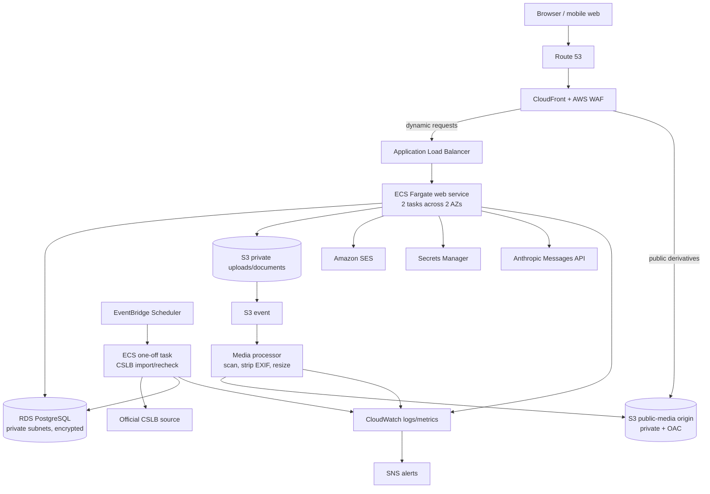
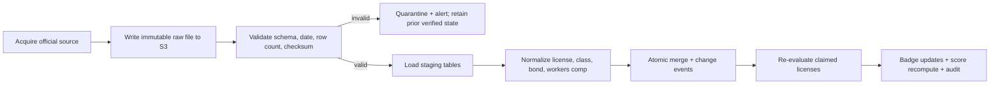

# System architecture

## 1. Architectural goals

- Ship an operable MVP in four weeks with no permanent in-house engineering team.
- Minimize moving parts and on-call burden without creating a dead-end prototype.
- Keep verification and ranking deterministic, explainable, and auditable.
- Isolate public media, private evidence, PII, and future payment metadata.
- Scale from an initial Bay Area launch to statewide traffic without a rewrite.

## 2. Recommended shape: modular monolith

One Django deployment contains independently owned modules:

| Module | Responsibility |
|---|---|
| `accounts` | Authentication, roles, MFA policy, sessions, consent |
| `vendors` | Vendor organizations, members, profiles, categories, service areas |
| `licenses` | CSLB source records, claims, reviews, verification history |
| `projects` | Project records, private homeowner association, public portfolio data |
| `media` | Direct uploads, scan/transform state, publication rules |
| `verification` | Homeowner confirmation invitations and decisions |
| `ranking` | Versioned deterministic score calculation and explanations |
| `search` | PostgreSQL full-text/trigram search and structured filters |
| `moderation` | Reports, review queue, decisions, optional LLM suggestions |
| `audit` | Append-only business audit events |
| `privacy` | Export, correction, deletion, retention workflow |
| `marketplace` | Phase 2 quotes, messages, contracts, milestones, disputes |
| `payments` | Phase 2 Stripe Connect references and webhook ledger |

The web application and REST API ship from the same container image. A second
container command runs administrative jobs. This avoids distributed transactions,
duplicate authorization logic, and premature service orchestration. Modules may be
extracted later at the API and outbox boundaries.

## 3. Open-source application stack

| Layer | Choice | Why |
|---|---|---|
| Backend | Python 3.13 + Django 5.x | Mature security model, migrations, forms, auth, and operations UI |
| API | Django REST Framework + drf-spectacular | Stable REST primitives and generated OpenAPI |
| UI | Django templates + HTMX + Alpine.js + Tailwind CSS | Fast delivery, excellent mobile response, little client state |
| Authentication | django-allauth, Argon2id password hashing | Self-hosted and portable; supports verified email and passkeys/OIDC later |
| Database | PostgreSQL 16+ | Transactions, JSONB, full-text search, trigram matching |
| Search | PostgreSQL FTS + `pg_trgm` | Avoids OpenSearch cost and operations at launch |
| Images | libvips/pyvips | Fast open-source resize, orientation, and metadata stripping |
| Malware scan | ClamAV in the media worker | Defense for private documents and uploads |
| Quality | Ruff, mypy, pytest, Factory Boy, Playwright | Automated static, unit, integration, and browser checks |
| IaC | OpenTofu or Terraform | Repeatable environment creation and drift review |
| Containers | Docker/OCI | Same artifact from CI through production |

Pin minor versions in lockfiles and automate dependency update pull requests. Do not
select a specific Claude model in source code; configure an approved model ID per
environment so model retirement does not require a release.

## 4. AWS production topology

Use `us-west-2`. It has broader service coverage and typically better redundancy than
`us-west-1`; the user-visible latency difference to the Bay Area is immaterial for this
application. Deploy across two Availability Zones.

### Network and edge

- CloudFront is the public entry point. WAF managed rules, bot/rate controls, and TLS
  apply there. ALB only accepts CloudFront-originated traffic using a managed prefix
  list/custom secret header control.
- Web tasks and RDS run in private subnets. RDS is never publicly reachable.
- Use VPC endpoints for S3, ECR, CloudWatch, and Secrets Manager where they reduce NAT
  traffic. A single NAT Gateway is an acceptable MVP cost tradeoff because direct
  Anthropic features are noncritical and fail gracefully; add one per AZ when the
  availability objective or traffic justifies it.
- Security groups allow only CloudFront/ALB to web, web/job to PostgreSQL, and required
  egress. No SSH; use ECS Exec with audited, time-bound IAM only for emergencies.

### Compute

- Production web service: two small Fargate tasks, one per AZ, with target-tracking on
  CPU and ALB request count. Start at 0.5 vCPU/1 GiB and load-test before launch.
- One-off ECS tasks run migrations, score recomputation, retention processing, and the
  CSLB job. EventBridge Scheduler invokes recurring jobs with retries and a DLQ.
- Media processing may be a Lambda container for bursty uploads or a Fargate worker.
  Prefer Lambda initially; use libvips and cap pixel count, file bytes, and execution time.

### Data and media

- RDS PostgreSQL: encrypted, Multi-AZ in production, automated backups, deletion
  protection, and point-in-time recovery. Start with a burstable instance and gp3 storage.
- Separate S3 buckets/prefixes and IAM roles for raw/private uploads and published
  derivatives. Block all public access; CloudFront reads published images through OAC.
- S3 versioning and lifecycle policies protect recent objects and expire abandoned raw
  uploads. Never expose private license evidence via CloudFront.
- Browser uploads go directly to S3 using short-lived, content-length-bound presigned
  requests. An object becomes publishable only after scan and transform completion.

## 5. Environment model

| Environment | Isolation | Availability/cost posture |
|---|---|---|
| Development | Local Docker Compose plus ephemeral CI database | Synthetic data only; Mailpit; fake S3/LocalStack optional |
| Staging | Non-production AWS account, its own namespace, secrets, buckets, and database | One web task; scheduled scale-down allowed; anonymized fixtures only |
| Production | Dedicated AWS account and VPC | Two web tasks, Multi-AZ RDS, deletion protection, strict IAM |

Staging and production are created from the same IaC modules with different variables.
Promotion deploys the same immutable image digest. Production access uses SSO roles;
there are no shared IAM users or long-lived CI access keys. GitHub Actions uses OIDC.

## 6. Deployment flow

1. Pull request runs formatting, lint, type checks, unit/integration tests, migration
   checks, dependency/container scans, and Playwright smoke tests.
2. Merge builds one signed image, generates an SBOM, pushes it to ECR, deploys staging,
   runs migrations as a one-off task, then runs smoke tests.
3. A manual approval promotes the exact image digest to production.
4. ECS rolling deployment requires healthy tasks before removing the previous revision.
5. Failed health checks or post-deploy smoke tests automatically roll back the service.

Database changes follow expand/migrate/contract. A release must remain compatible with
the previous schema during a rolling deployment. Destructive migrations require a later
release after data migration and backup verification.

## 7. CSLB verification pipeline

CSLB data acquisition is an adapter with immutable source snapshots, not page scraping.
The launch implementation must confirm one of these official routes:

1. Register for the CSLB license-data web service and recheck all claimed vendor license
   numbers weekly; or
2. Download an authorized Public Data Portal file on the permitted schedule, preserving
   its checksum and import metadata; optionally supplement with paid full/update files.

The scheduled pipeline is:

Safety rules:

- Never revoke every badge because a source file is empty, stale, or structurally new.
- Persist `source_as_of`, `fetched_at`, source URL/method, checksum, parser version, and
  counts. Alert when freshness exceeds eight days.
- A license is automatically verified only on exact normalized license-number match and
  acceptable CSLB status. Business-name mismatch or ambiguous record enters review.
- CSLB may change status at any time. Show users the last checked timestamp and link to
  the official lookup. “Verified” means matched to the latest successful platform check,
  not a guarantee of quality, identity, insurance, or current legal standing.
- Badge removal is automatic for expired, suspended, cancelled, or otherwise ineligible
  status. Restoration after a later good record is automatic unless an admin hold exists.

## 8. Anthropic integration boundary

Claude is optional and assistive in the MVP:

- suggest a neutral project summary from vendor-provided text;
- suggest image alt text from already-public/project-safe images;
- flag potentially abusive, promotional, or PII-bearing text for human moderation.

Claude must not determine CSLB status, vendor score, badge eligibility, content removal,
dispute outcomes, contract terms, or payment release. Every suggestion is labeled and
reviewable; outage or quota exhaustion cannot block profile/project creation.

Implementation requirements:

- `LLMProvider` interface with an Anthropic Messages API adapter and a disabled/fake adapter.
- Service-account API key in Secrets Manager, never in browser code, logs, images, or repo.
- Separate workspaces/keys per environment, budgets and rate limits, model allowlist, short
  timeouts, bounded retries, circuit breaker, and cost/latency metrics.
- Redact email, phone, street address, homeowner identity, license documents, messages,
  payment information, and EXIF before a request. Store prompt template version, purpose,
  model ID, token counts, latency, and decision disposition—not raw sensitive prompts.
- Use structured JSON output validated against a strict schema. Treat all user content as
  untrusted data and never grant the model tools or database access in the MVP.

## 9. Scale path

Scale vertically and add Fargate tasks first. Add PgBouncer/RDS Proxy only when connection
pressure requires it. Add Redis for cache/queues only when measured workload justifies the
extra service. Move search to OpenSearch only after PostgreSQL query plans and indexes no
longer meet the target. Extract media, messaging, or payments only after their independent
load or change cadence warrants it.

## 10. Service objectives

- Public browse/API monthly availability target: 99.9% after launch stabilization.
- p95 server response: under 500 ms for cached browse and under 1 s for uncached search,
  excluding image transfer and third-party calls.
- Recovery point objective: at most 15 minutes for PostgreSQL; 24 hours for regenerated
  public derivatives; raw objects protected by versioning.
- Recovery time objective: 4 hours for the application/database, 8 hours for noncritical
  media reprocessing.
- Weekly CSLB check completes within 12 hours of schedule and data freshness is visible.
