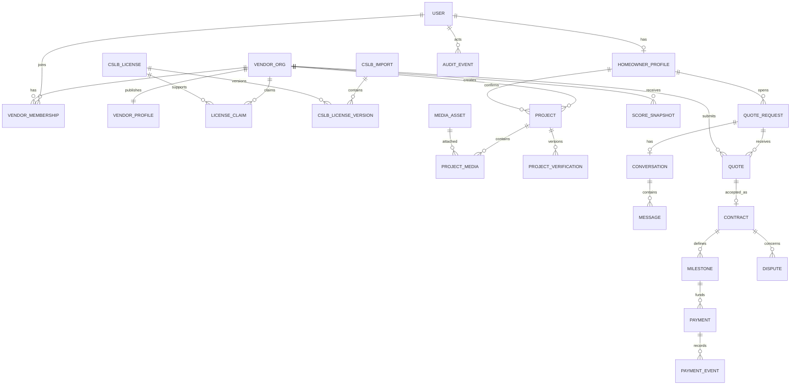

# Data model

## 1. Conventions

- PostgreSQL UUID primary keys generated server-side.
- `timestamptz` in UTC; UI renders the user's zone.
- Money is integer minor units plus ISO currency, never floating point.
- Emails are case-insensitive (`citext`) and encrypted where business need allows; hashes
  support controlled matching where plaintext is unnecessary.
- Soft deletion is explicit (`deleted_at`, status); retention jobs hard-delete eligible PII.
- Business audit events are append-only and separate from mutable record timestamps.
- Every external event/import has an idempotency key and original-source reference.

## 2. Relationship overview

## 3. Identity and access

### `users`

`id`, `email`, `password_hash`, `primary_role`, `email_verified_at`, `status`,
`last_login_at`, `auth_version`, `created_at`, `updated_at`, `deleted_at`.

Constraints: unique normalized email; roles `homeowner|vendor|admin`; status
`pending|active|locked|deletion_pending|deleted`. Admin is assigned only through a
privileged audited command.

### `homeowner_profiles`

`user_id`, `display_name_private`, `phone_encrypted`, `created_at`, `updated_at`.
Nothing in this table is public.

### `vendor_organizations`

`id`, `legal_name`, `status`, `created_by`, `created_at`, `updated_at`, `deleted_at`.

### `vendor_memberships`

`id`, `vendor_org_id`, `user_id`, `role`, `status`, `invited_at`, `accepted_at`.
Unique active `(vendor_org_id,user_id)`. Roles `owner|manager|editor`.

### `consent_records`

`id`, `user_id`, `document_type`, `document_version`, `action`, `occurred_at`,
`ip_prefix`, `user_agent_hash`. Store minimized evidence, not raw IP indefinitely.

## 4. Vendor profile and taxonomy

### `vendor_profiles`

`vendor_org_id`, `slug`, `display_name`, `description`, `public_phone`, `public_email`,
`website_url`, `publication_status`, `moderation_status`, `published_at`, `updated_at`.

### Reference and join tables

- `service_categories(id, slug, name, active, sort_order)`
- `vendor_categories(vendor_org_id, category_id)`
- `counties(id, state_code, name, fips_code, launch_enabled)`
- `cities(id, county_id, name, normalized_name, active)`
- `vendor_service_counties(vendor_org_id, county_id)`
- `vendor_service_cities(vendor_org_id, city_id)`
- `license_classifications(code, name, description, active)`

Search indexes: GIN FTS document, trigram indexes on display/legal name, B-tree indexes on
publication/moderation state, service joins, and score.

## 5. CSLB source and license claims

### `cslb_imports`

`id`, `source_type`, `source_uri`, `source_as_of`, `fetched_at`, `completed_at`,
`sha256`, `parser_version`, `raw_object_key`, `row_count`, `accepted_count`,
`rejected_count`, `status`, `failure_reason`.

Raw file is immutable. Status `fetching|validating|quarantined|merging|succeeded|failed`.

### `cslb_licenses`

Stable normalized identity: `license_number` primary/unique, `latest_version_id`,
`first_seen_at`, `last_seen_at`.

### `cslb_license_versions`

`id`, `license_number`, `import_id`, `business_name`, `status_code`, `status_label`,
`issue_date`, `expiration_date`, `address_public_json`, `bond_status`, `bond_amount`,
`bond_company`, `workers_comp_status`, `workers_comp_carrier`, `workers_comp_expiration`,
`classification_codes[]`, `source_payload_json`, `payload_hash`, `observed_at`.

Unique `(license_number,payload_hash)` or equivalent temporal deduplication. Keep source
payload for audit subject to source terms; expose only approved fields publicly.

### `license_claims`

`id`, `vendor_org_id`, `license_number`, `state`, `match_type`, `matched_version_id`,
`verified_at`, `last_checked_at`, `ineligible_reason`, `admin_hold`, `reviewed_by`,
`reviewed_at`, `review_reason_code`, `created_at`, `updated_at`.

Partial unique index permits one active claim per license. Do not cascade-delete source facts.

### `license_claim_events`

`id`, `claim_id`, `from_state`, `to_state`, `reason_code`, `source_version_id`, `actor_type`,
`actor_id`, `metadata_json`, `occurred_at`. Append-only.

## 6. Projects, verification, and media

### `projects`

`id`, `vendor_org_id`, `created_by`, `category_id`, `title`, `description`, `scope_json`,
`county_id`, `city_id`, `private_address_encrypted`, `start_date`, `end_date`, `status`,
`moderation_status`, `material_version`, `published_at`, `created_at`, `updated_at`,
`deleted_at`.

Status `draft|verification_pending|correction_requested|confirmed|published|rejected|removed`.
Check `start_date <= end_date`; publication requires a current confirmed material version.

### `project_participants`

`project_id`, `homeowner_user_id`, `invited_email_ciphertext`, `invited_email_hash`,
`relationship`, `created_at`. Only one confirming homeowner in MVP, but table supports more.

### `project_verification_invitations`

`id`, `project_id`, `email_hash`, `token_hash`, `project_material_version`, `expires_at`,
`sent_at`, `consumed_at`, `revoked_at`, `send_count`. Never store the raw token.

### `project_verifications`

`id`, `project_id`, `homeowner_user_id`, `project_material_version`, `decision`,
`reason_code`, `private_note_encrypted`, `project_snapshot_json`, `decided_at`, `invalidated_at`.

Unique `(project_id,project_material_version,homeowner_user_id)`. Decisions
`confirmed|rejected|correction_requested`.

### `media_assets`

`id`, `owner_user_id`, `bucket_scope`, `raw_object_key`, `sha256`, `perceptual_hash`,
`detected_mime`, `byte_size`, `width`, `height`, `scan_status`, `processing_status`,
`moderation_status`, `metadata_stripped`, `created_at`, `ready_at`, `deleted_at`.

### `media_variants`

`id`, `media_asset_id`, `variant`, `format`, `object_key`, `width`, `height`, `byte_size`.
Unique `(media_asset_id,variant,format)`.

### `project_media`

`project_id`, `media_asset_id`, `kind`, `sort_order`, `caption`, `alt_text`, `created_at`.
Kinds `before|after|other`; unique attachment and sort constraints.

## 7. Score, moderation, audit, privacy

### `vendor_score_snapshots`

`id`, `vendor_org_id`, `formula_version`, `score`, `license_points`, `project_points`,
`recency_points`, `photo_points`, `input_json`, `explanation_json`, `trigger_type`,
`trigger_id`, `computed_at`. Append-only; vendor profile points at latest snapshot.

### `content_reports` and `moderation_actions`

Report stores reporter, target type/id, reason, private details, state, timestamps.
Action stores target, action (`allow|hide|remove|restore|restrict`), structured reason,
admin, optional LLM suggestion reference, and timestamps. LLM output is never the action.

### `audit_events`

`id`, `occurred_at`, `actor_type`, `actor_id`, `request_id`, `action`, `target_type`,
`target_id`, `before_hash`, `after_hash`, `reason_code`, `metadata_json`, `prev_event_hash`,
`event_hash`. Partition monthly; application role has insert/select but not update/delete.
Periodically export signed partitions/checkpoints to Object Lock-protected S3.

### `privacy_requests`

`id`, `user_id`, `request_type`, `status`, `identity_verified_at`, `due_at`, `completed_at`,
`result_object_key`, `denial_reason`, `created_at`. Types `access|delete|correct|limit|opt_out`.

## 8. Phase 2 tables

These tables reserve boundaries, not a counsel-approved payment implementation.

- `quote_requests`: homeowner, project brief, location, budget range, desired dates, state.
- `quote_request_vendors`: request, vendor, invitation/response state.
- `quotes`: request, vendor, version, scope snapshot, price, dates, state, expires_at.
- `quote_line_items`: quote/version, description, quantity/units, amount.
- `conversations`: quote request/contract context, state.
- `conversation_participants`: conversation, user, role, last_read_at, blocked_at.
- `messages`: conversation, sender, body ciphertext, sent_at, edited_at, redacted_at.
- `message_media`: message, private media asset.
- `contracts`: accepted quote/version, parties, rendered document hash/key, state, signed times.
- `contract_versions`: immutable terms/scope/payment schedule/change order snapshots.
- `milestones`: contract version, order, title, amount, due criteria, state, timeout policy.
- `stripe_accounts`: vendor, Connect account ID, onboarding/payout capability state.
- `payments`: contract/milestone, Stripe object IDs, amount/currency, state, idempotency key.
- `payment_events`: provider event ID, type, signature verification, payload object key/hash,
  processing state, attempts, occurred/received times. Unique provider event ID.
- `ledger_entries`: balanced debit/credit entries referencing payments/refunds/transfers.
- `disputes`: contract/payment, opened_by, category, state, hold state, assigned_admin.
- `dispute_events`: immutable evidence/action/proposal/outcome timeline.

No payment state transition is inferred solely from a browser redirect. Signed Stripe
webhooks and idempotent reconciliation own provider state.

## 9. Retention baseline requiring counsel approval

| Data | Proposed policy |
|---|---|
| Unused raw uploads | Delete after 24 hours |
| Rejected/quarantined media | Delete after 30 days unless security hold |
| License evidence documents | Delete 90 days after decision unless dispute/legal hold |
| Account security logs | 12 months |
| Application logs | 30 days hot; 12 months archive for security subset |
| Project confirmation evidence | Life of published claim + 4 years, subject to counsel |
| Audit events | 7 years for high-impact verification/payment records, subject to counsel |
| Privacy export | Expire download after 7 days; delete artifact after 30 days |

Deletion jobs must honor legal holds, preserve non-PII aggregate/source facts where lawful,
and record completion evidence without retaining the deleted content.
